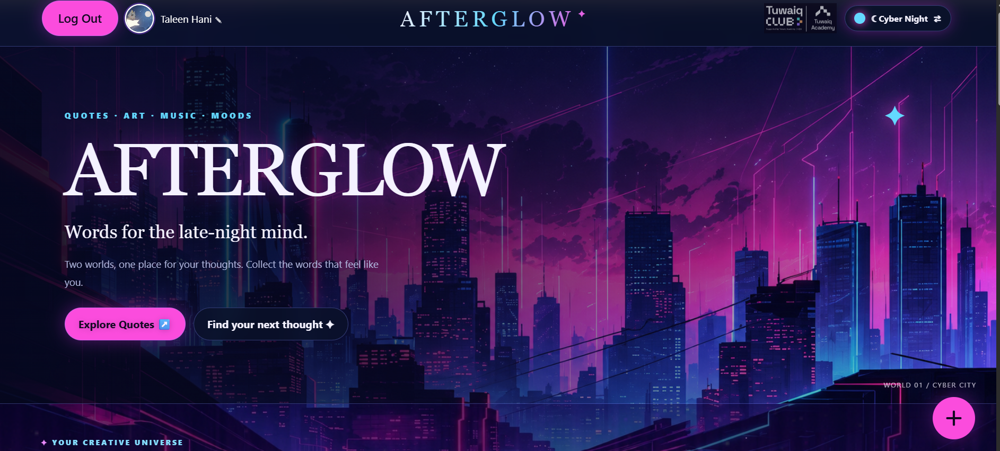
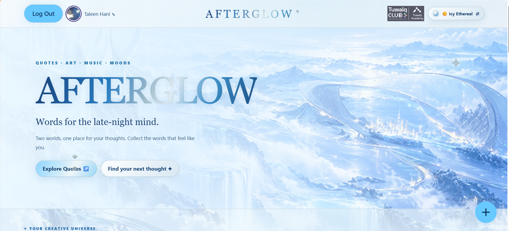
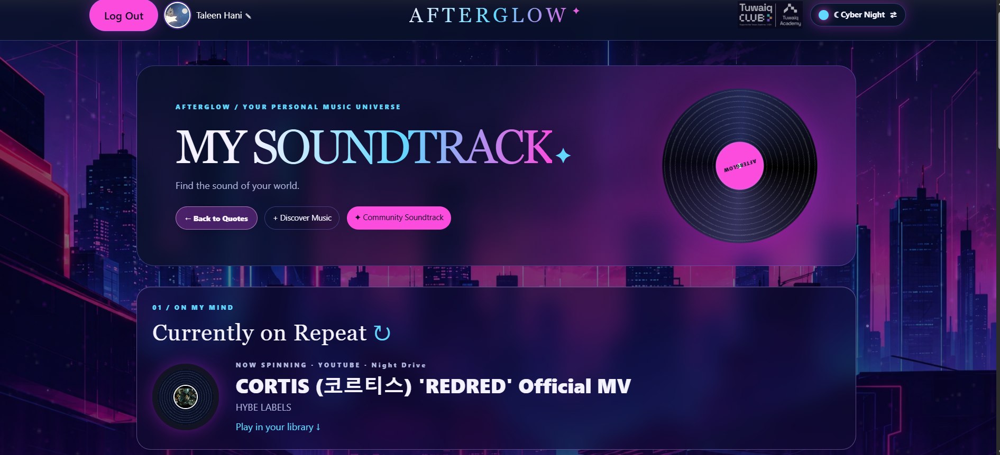
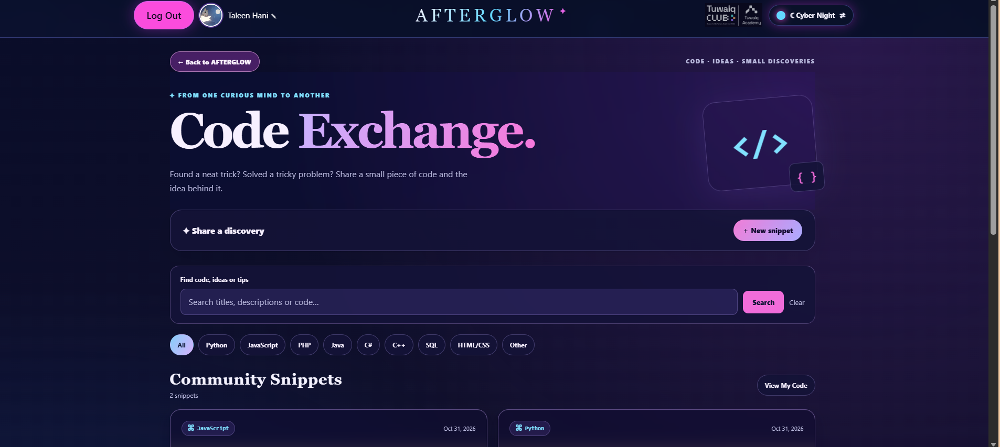
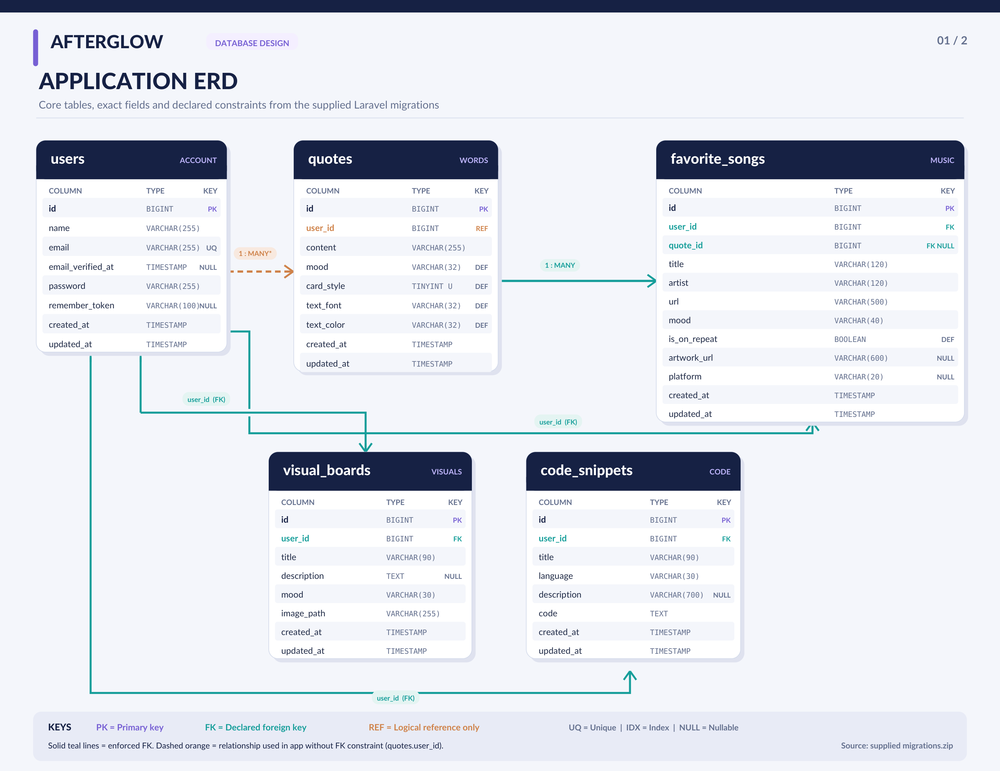
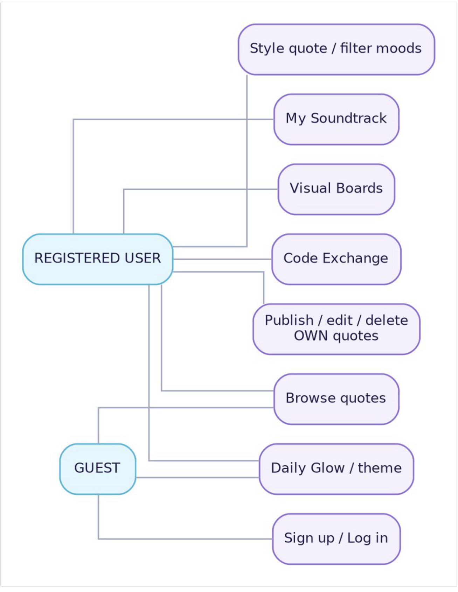

# 🌌 AFTERGLOW v3

### A Creative Full-Stack Community Platform

AFTERGLOW is a full-stack web application built with **Laravel, PHP, JavaScript, and PostgreSQL**. It provides an interactive space where users can express themselves through quotes, visual boards, code snippets, and curated music collections.

The platform combines creative expression, community interaction, and personalized user experiences.

**Live Website:** [Explore AFTERGLOW](https://afterglow-c5hw.onrender.com)

**Repository:** [GitHub — AFTERGLOW](https://github.com/taleen1717/AFTERGLOW)

---

## ✨ Key Features

### 💬 Quotes & Social Interaction
- Create, edit, and delete personal quotes.
- Explore shared quotes from the community.
- Customize quote appearances and styles.
- Like and comment on shared quotes.
- Protect content through ownership-based permissions.

### 🎨 Visual Boards
- Create and share personalized visual boards.
- Explore creative content from other users.
- Support community engagement through likes and comments.

### 💻 Code Exchange
- Share programming snippets with the community.
- Browse and copy code snippets.
- Like and comment on shared code.
- Encourage knowledge sharing between developers.
- Display code without executing it on the server.

### 🎵 My Soundtrack
- Build a personal music collection.
- Integrate Spotify and YouTube content.
- Automatically retrieve available Spotify song metadata and artwork.
- Play supported media using official embedded players.
- Organize favorite songs by mood.
- Attach songs to personal quotes.
- Choose between public and private music sharing.
- Discover and interact with publicly shared songs.

### 👤 User Profiles
- User registration and authentication.
- Editable profile information and biography.
- Profile avatar support.
- Secure password management.
- User-specific content management and privacy controls.

### 🌃 Personalized Design
AFTERGLOW features two distinct visual experiences:

- **Cyber City Night:** Neon-inspired dark visuals with purple, pink, and blue accents.
- **Icy Ethereal:** A bright, futuristic interface with icy tones.

---

## 📸 Project Screenshots

### 🌌 Two Distinct Visual Worlds

| Cyber Night | Icy Ethereal |
|---|---|
|  |  |

### 🎵 My Soundtrack

### 💻 Code Exchange

---

## 🛠 Technology Stack

| Category | Technologies |
|---|---|
| Backend | PHP 8.4, Laravel 13 |
| Frontend | Blade, HTML, CSS, JavaScript |
| Asset Bundling | Vite, Node.js |
| Database | PostgreSQL, SQLite for local development |
| Database Hosting | Neon |
| Cloud Deployment | Render, Docker |
| Image Storage | Cloudinary |
| Music Integration | Spotify Web API, Spotify oEmbed, YouTube Data API |
| Version Control | Git, GitHub |
| Testing | Pest, Laravel Feature Tests, GitHub Actions |

---

## 🏗 Architecture

AFTERGLOW follows Laravel's Model-View-Controller (MVC) architecture.

- **Models:** Manage application entities and database relationships.
- **Views:** Render the user interface using Blade templates.
- **Controllers:** Handle requests, application logic, and user interactions.
- **Middleware & Validation:** Support authentication, authorization, and input validation.
- **Database Migrations:** Manage database schema changes.
- **External Integrations:** Connect Spotify, YouTube, and Cloudinary.

The application uses PostgreSQL in production and supports SQLite for local development.

---

## 🚀 Local Installation

### Prerequisites

- PHP 8.4 and Composer
- Node.js 22 and npm
- Required PHP extensions
- A supported database

### Setup

**1. Clone the repository**

`git clone https://github.com/taleen1717/AFTERGLOW.git`

`cd AFTERGLOW`

**2. Install dependencies**

`composer install`

`npm ci`

**3. Configure the environment**

Copy `.env.example` to `.env`, then configure the required local environment variables.

For SQLite development, create `database/database.sqlite` if it does not already exist.

**4. Generate the application key**

`php artisan key:generate`

**5. Run database migrations**

`php artisan migrate`

**6. Build frontend assets**

`npm run build`

**7. Start the development server**

`php artisan serve`

Visit the local URL shown in the terminal.

For frontend development with automatic asset rebuilding, run `npm run dev` in a separate terminal.

Spotify and YouTube functionality may require additional API credentials configured through environment variables.

---

## 🧪 Testing & Quality Assurance

AFTERGLOW includes automated feature and regression tests covering:

- Authentication and authorization
- Quote management and ownership
- Likes and comments
- User profile management
- Code Exchange interactions
- Spotify metadata and artwork
- Music privacy and community discovery
- Input validation

**Latest verified local test run:**
- 34 tests passed
- 156 assertions
- 0 failures

Run the complete test suite:

`php artisan test`

GitHub Actions also runs Laravel tests for pull requests.

---

## 📚 Project Documentation

Project documentation is organized in the [`docs/`](docs/) directory, including requirements, database design materials, and development references.

Additional documents include:

- [Version 2 Requirements](docs/AFTERGLOW_V2_REQUIREMENTS.md)
- [Version 3 Social Interactions](docs/AFTERGLOW_V3_INTERACTIONS.md)
- Software Requirements Specification (SRS)
- Entity Relationship Diagram (ERD)

---

## 🔐 Security & Privacy

AFTERGLOW implements:

- Authentication-protected user interactions.
- Ownership checks for editing and deleting content.
- Input validation and comment-length restrictions.
- Public/private visibility settings for saved songs.
- Private music content protection.
- Database constraints for preventing duplicate likes.
- Environment-based management of application credentials.

Sensitive configuration files, database credentials, API keys, and private data must never be committed to the repository.

---

## ☁️ Deployment

AFTERGLOW is deployed as a Docker-based Laravel application on Render.

The production environment uses:

- **Render:** Application hosting
- **Neon PostgreSQL:** Database hosting
- **Cloudinary:** Image storage
- **GitHub:** Source control and CI workflows

The Docker startup process applies pending Laravel migrations before starting the Apache web server. Production migrations should be tested and backed up before deployment.

---

## 🎯 Project Outcomes

AFTERGLOW demonstrates practical full-stack development skills, including:

- Designing relational database structures.
- Building frontend and backend functionality.
- Implementing CRUD operations and authorization.
- Integrating third-party APIs.
- Managing cloud-based infrastructure.
- Writing automated tests.
- Applying database migrations.
- Deploying and maintaining a production web application.

---

### 🌌 AFTERGLOW — Create. Share. Connect.

*Developed as a full-stack web development project.*

---

## 📐 System Design & Documentation

AFTERGLOW was developed with a structured software engineering approach, including requirements analysis, database design, implementation, and testing.

### Entity Relationship Diagram (ERD)

[View Complete ERD (PDF)](docs/AFTERGLOW_v2_ERD.pdf)

### Use Case Diagram

### Project Documentation

- [Software Requirements](docs/AFTERGLOW_V2_REQUIREMENTS.md)
- [SRS Addendum (PDF)](docs/AFTERGLOW_v2_SRS_Addendum.pdf)
- [V3 Social Interactions](docs/AFTERGLOW_V3_INTERACTIONS.md)
- [Deployment Checklist](docs/AFTERGLOW_V3_DEPLOY_CHECKLIST.md)

---
